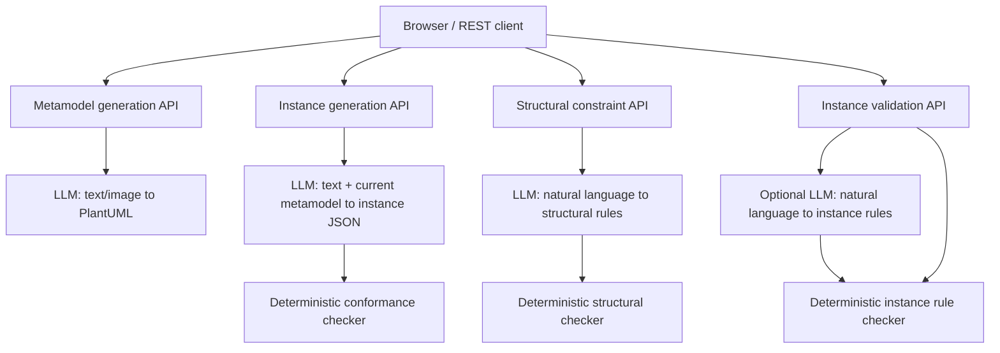
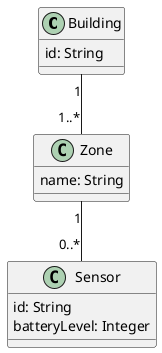

# Metamodel Studio

**LLM-assisted metamodel and instance generation with deterministic structural and instance-level validation.**

Metamodel Studio is a Node-RED web application and REST API for creating domain metamodels from natural-language descriptions and images, generating concrete model instances from text, and checking model constraints. It combines generative AI for **authoring and translating requirements** with a JavaScript engine for **repeatable, rule-based checking**. An LLM never supplies the final validation verdict.

> **Scope:** This is a prototype for a supported subset of PlantUML class diagrams and an OCL-inspired structured rule language. It is **not** a full PlantUML parser, an Eclipse OCL interpreter, or a formal verification system. Review LLM-generated models and rule mappings before relying on results.

## Features

- **Multimodal metamodel generation:** describe a domain in text, upload a diagram/sketch, or combine both; receive editable PlantUML class-diagram source.
- **Structural constraint validation:** express constraints in natural language; an LLM maps them to a restricted rule representation, then a deterministic checker evaluates the current metamodel.
- **Text-to-instance generation:** describe concrete objects and relationships; an LLM proposes an instance model using the *current edited* PlantUML metamodel as its schema.
- **JSON instance import/export:** import an existing instance model, edit JSON directly, and download the result.
- **Deterministic instance conformance:** check declared classes, attribute types, object references, compatible links, and supported association multiplicities.
- **Instance-level constraints:** check attribute comparisons, uniqueness, object counts, and per-object link counts. Submit structured rules directly to avoid LLM mapping.
- **Web UI and REST API:** a single browser page exposes all workflows, backed by Node-RED HTTP endpoints.
- **Explicit outcomes:** `PASS`, `FAIL`, and `NOT_EVALUATED` at the check level; overall instance results use `PASS`, `FAIL`, or `INCOMPLETE`.

## Architecture



**Key principle:** LLM outputs are *proposals* (PlantUML, instance JSON, or structured rules). Validation is computed by Node-RED JavaScript functions without asking the LLM whether a constraint is satisfied. The correctness of the translation from natural language to a rule is not itself formally guaranteed.

## Repository contents

| File | Purpose |
| --- | --- |
| `node_red_metamodel_with_generated_instances.json` | Complete Node-RED flow: UI, generation, constraint mapping, deterministic validators, and REST endpoints |
| `metamodel_generated_instances_web_page.html` | Standalone HTML copy of the web interface; the flow also embeds the UI in a Node-RED Template node |
| `README.md` | Main documentation |
| `README_metamodel_generated_instances.md` | Short deployment and API notes (optional) |

The JSON flow is the main deployable artifact. The separate HTML file is useful for inspecting or editing the interface, but the flow's embedded Template node is what serves `/metamodel-ui`.

## Requirements

- Node.js and a working **Node-RED** installation with the standard `http in`, `http response`, `function`, `template`, and `http request` nodes.
- An OpenAI-compatible **Chat Completions** endpoint and an API key; image-based generation requires a vision-capable model.
- A modern browser.
- Internet access if using a hosted LLM endpoint or the optional external diagram preview.

No external Node-RED validation or OCL plugin is required by the supplied flow.

## Installation

1. Start Node-RED and open the editor at `http://127.0.0.1:1880`.
2. Back up your existing flow. **Disable or remove older Metamodel Studio routes** before importing this version; duplicate HTTP paths can cause ambiguous behavior.
3. In the Node-RED menu, choose **Import**, select `node_red_metamodel_with_generated_instances.json`, and import it.
4. Set the environment variables described below and restart Node-RED if needed.
5. Click **Deploy**.
6. Open **http://127.0.0.1:1880/metamodel-ui**.

**Windows CMD, current session:**

```cmd
set "OPENAI_API_KEY=YOUR_API_KEY"
set "OPENAI_MODEL=gpt-5.5"
node-red
```

Set the variables **before launching Node-RED**. For a persistent setup, configure environment variables in Windows or in your Node-RED service environment; avoid committing keys to Git.

| Environment variable | Required | Description |
| --- | --- | --- |
| `OPENAI_API_KEY` | Yes for LLM workflows | API credential used by Node-RED's HTTP Request nodes |
| `OPENAI_MODEL` | Optional | Model ID; defaults vary by node (`gpt-4o` for metamodel generation, `gpt-5.5` for rule mapping and instance generation) |
| `OPENAI_BASE_URL` | Optional | OpenAI-compatible API base URL; defaults to `https://api.openai.com/v1` |

The default model IDs and token settings must be supported by your provider. If an endpoint rejects a parameter or model, update the corresponding Node-RED Function node. The flow uses `max_completion_tokens`, not `max_tokens`.

### Browser and CORS

All web UI calls to the Node-RED API target **`http://127.0.0.1:1880`**. Serve the page from `http://127.0.0.1:1880/metamodel-ui` rather than opening the `.html` file using `file://`: a file-origin page may trigger CORS restrictions. `127.0.0.1` means the machine running the **browser**, so this default is intended for a local deployment.

### PlantUML preview

The **Preview diagram (external service)** button sends PlantUML text to `https://kroki.io/plantuml/svg`. This is separate from the local REST APIs and may disclose model source to the external service. Do not use it for confidential models unless authorized. You can always download `.puml` without using the preview service.

## Quick start

### 1. Create a metamodel

Enter a description such as:

> A Building contains one or more Zones. Each Zone may contain Sensors. Each Sensor has an identifier of type String and a batteryLevel of type Integer.

Optionally upload a PNG, JPEG, WEBP, or GIF sketch (maximum 8 MB), then click **Generate metamodel**. Review and edit the returned PlantUML. For example:



This is an **illustrative** metamodel; the LLM's actual output may differ.

### 2. Check metamodel constraints

Enter one requirement per line in **Validate structural constraints**, for example:

```text
Building must have an id attribute of type String.
Building must be associated with Zone.
Sensor must inherit from IoTDevice.
```

Click **Check constraints**. The LLM translates each line to a supported structural predicate. The JavaScript checker evaluates the predicates against the PlantUML source. The inheritance requirement should fail for the example above, because `IoTDevice` is not declared as a parent.

### 3. Generate instances from text

In **Instance model editor**, enter:

> Create Building B-001 with one Zone named Ground Floor and two Sensors. Give the sensors battery levels 85 and 15.

Click **Generate instances from text (LLM)**. The generated JSON is inserted into the editable instance field and checked for deterministic structural conformance. An illustrative instance document is:

```json
{
  "objects": [
    {"id": "b1", "type": "Building", "attributes": {"id": "B-001"}},
    {"id": "z1", "type": "Zone", "attributes": {"name": "Ground Floor"}},
    {"id": "s1", "type": "Sensor", "attributes": {"id": "S-1", "batteryLevel": 85}},
    {"id": "s2", "type": "Sensor", "attributes": {"id": "S-2", "batteryLevel": 15}}
  ],
  "links": [
    {"source": "b1", "target": "z1"},
    {"source": "z1", "target": "s1"},
    {"source": "z1", "target": "s2"}
  ]
}
```

The actual instance JSON is LLM-generated and may require correction. You can also **import a `.json` file**, edit the JSON, and download it.

### 4. Check instance constraints

Enter one requirement per line:

```text
Every Sensor must have batteryLevel greater than or equal to 20.
Sensor identifiers must be unique.
Each Zone must be linked to at least two Sensors.
```

Click **Validate instance model**. With the illustrative instances above and correctly mapped rules, sensor `s2` fails the battery-level constraint. All verdicts are computed by JavaScript.

For fully deterministic **rule submission and evaluation** (no LLM call), paste the following into **Optional structured rules JSON**:

```json
[
  {"type": "attribute_compare", "class": "Sensor", "attribute": "batteryLevel", "operator": ">=", "value": 20},
  {"type": "unique_attribute", "class": "Sensor", "attribute": "id"},
  {"type": "link_count", "class": "Zone", "targetClass": "Sensor", "operator": ">=", "value": 2}
]
```

The structured rules field takes precedence over the natural-language constraint field.

## REST API reference

**Base URL:** `http://127.0.0.1:1880`

| Method | Endpoint | Purpose | LLM involved? |
| --- | --- | --- | --- |
| `GET` | `/metamodel-ui` | Serve the web interface | No |
| `POST` | `/api/metamodel` | Generate PlantUML from text/image | Yes |
| `POST` | `/api/metamodel/validate` | Map and check structural constraints | Mapping only |
| `POST` | `/api/metamodel/instances/generate` | Generate JSON instances and check conformance | Generation only |
| `POST` | `/api/metamodel/instances/validate` | Check instance conformance and rules | Only if natural-language mapping is needed |

### `POST /api/metamodel`

**Content type:** `multipart/form-data`.

| Field | Type | Notes |
| --- | --- | --- |
| `description` | string | Optional if an image is supplied; maximum 12,000 characters. `text` is also accepted. |
| `image` | file | Optional if text is supplied; PNG/JPEG/WEBP/GIF, maximum 8 MiB. |

```cmd
curl.exe -X POST http://127.0.0.1:1880/api/metamodel -F "description=A Building contains Zones and Sensors"
```

Successful response (representative):

```json
{
  "plantuml": "@startuml\nclass Building\nclass Zone\nBuilding -- Zone\n@enduml",
  "format": "plantuml",
  "diagramType": "class",
  "source": "generated"
}
```

### `POST /api/metamodel/validate`

**Content type:** `application/json`. Both `plantuml` and `constraints` are required strings. Put **one constraint per line**.

```json
{
  "plantuml": "@startuml\nclass Building {\n id: String\n}\n@enduml",
  "constraints": "Building must exist.\nBuilding must have an id attribute of type String."
}
```

The server asks the LLM to return one structural rule per nonempty constraint line, then checks the rules deterministically. Supported structural rule types include:

- `class_exists`
- `attribute_exists` (optionally including `attributeType`)
- `association_exists`
- `inherits`
- `multiplicity` (exact declared association-end multiplicity)
- `unsupported` (reported as unevaluated)

Response includes `status`, `summary`, `results`, and the mapped rules. A failed mapping request is an API error, not a validation verdict.

### `POST /api/metamodel/instances/generate`

**Content type:** `application/json`.

```json
{
  "plantuml": "@startuml\nclass Building {\n id: String\n}\nclass Zone\nBuilding \"1\" -- \"1..*\" Zone\n@enduml",
  "description": "Create Building B-001 and one Zone."
}
```

Response (shape):

```json
{
  "instances": {"objects": [], "links": []},
  "validation": {
    "status": "PASS",
    "summary": {"passed": 1, "failed": 0, "notEvaluated": 0},
    "results": []
  },
  "generation": "LLM proposal",
  "validationEngine": "deterministic JavaScript",
  "metamodelSource": "request PlantUML"
}
```

This is a **schema illustration**, not a guaranteed output for the example request. Actual `instances` and validation results depend on the generated objects and links. The generation endpoint performs conformance checking; it does **not** automatically apply additional user-supplied instance constraints.

### `POST /api/metamodel/instances/validate`

**Content type:** `application/json`.

With natural-language constraints (requires an LLM for rule mapping):

```json
{
  "plantuml": "@startuml\nclass Sensor {\n batteryLevel: Integer\n}\n@enduml",
  "instances": {
    "objects": [{"id": "s1", "type": "Sensor", "attributes": {"batteryLevel": 15}}],
    "links": []
  },
  "constraints": "Every Sensor must have batteryLevel greater than or equal to 20."
}
```

With already structured rules (**no LLM call**):

```json
{
  "plantuml": "@startuml\nclass Sensor {\n batteryLevel: Integer\n}\n@enduml",
  "instances": {
    "objects": [{"id": "s1", "type": "Sensor", "attributes": {"batteryLevel": 15}}],
    "links": []
  },
  "rules": [
    {"type": "attribute_compare", "class": "Sensor", "attribute": "batteryLevel", "operator": ">=", "value": 20}
  ]
}
```

To check **conformance only**, supply `"rules": []`.

Supported instance rule types:

| Rule | Fields | Meaning |
| --- | --- | --- |
| `attribute_compare` | `class`, `attribute`, `operator`, `value` | Per-object comparison; operators `==`, `!=`, `>`, `>=`, `<`, `<=`, `nonempty` |
| `unique_attribute` | `class`, `attribute` | Attribute values unique among matching instances |
| `object_count` | `class`, `operator`, `value` | Count objects of a class |
| `link_count` | `class`, `targetClass`, `operator`, `value` | Count linked target-class objects per source object |
| `unsupported` | `reason` | Explicitly mark a requirement that cannot be evaluated |

Example response (abbreviated):

```json
{
  "status": "FAIL",
  "summary": {"passed": 0, "failed": 1, "notEvaluated": 0},
  "results": [
    {
      "status": "FAIL",
      "constraint": "Rule 1",
      "reason": "Attribute predicate violated.",
      "objectId": "s1",
      "type": "rule"
    }
  ],
  "rules": [
    {"type": "attribute_compare", "class": "Sensor", "attribute": "batteryLevel", "operator": ">=", "value": 20}
  ],
  "engine": "deterministic-instance-validator-v1"
}
```

Other conformance results may also be present; the sample is illustrative. For rule results, `PASS` means the supported predicate was satisfied, `FAIL` means a violation was detected, and `NOT_EVALUATED` means it could not be checked. Overall `INCOMPLETE` indicates at least one unevaluated check and no failures.

## Instance JSON schema

The instance representation is a lightweight JSON graph:

```json
{
  "objects": [
    {"id": "unique-object-id", "type": "DeclaredClass", "attributes": {"name": "value"}}
  ],
  "links": [
    {"source": "object-id-1", "target": "object-id-2"}
  ]
}
```

Object IDs identify individual instances. `type` refers to a class in the metamodel. Attribute values should match declared types. Link endpoints must reference existing object IDs, and links must be compatible with declared associations. The validator checks supported inheritance and multiplicities. Links do **not** include association-role identifiers; models with multiple associations between the same classes can therefore be ambiguous and may produce `NOT_EVALUATED` checks.

## Deterministic validation and limitations

The validation functions use explicit parsing and comparisons, not LLM judgments, `eval`, or execution of user-supplied code. This provides repeatable outcomes **for the same parsed metamodel, instance JSON, and structured rules**.

Important limitations:

1. **Natural-language mapping is probabilistic.** A plausible but incorrect mapping may be evaluated consistently yet fail to represent the intended requirement. Review returned `rules`.
2. **PlantUML support is partial.** The checker uses a restricted parser for class declarations, typed attributes, inheritance, and selected association syntax; unsupported constructs may not be understood.
3. **No full OCL interpreter.** Arbitrary OCL expressions, navigation, quantifiers, derived features, temporal conditions, and user-defined operations are not implemented.
4. **Conformance is not semantic completeness.** The checker does not prove that the generated metamodel fully captures the domain or that the instance model matches the real world.
5. **No persistent model repository.** Models are held in the browser and request payloads unless you add storage to the flow. Export JSON or `.puml` to retain them.
6. **No automatic correction.** Failed checks are reported, not silently fixed by an LLM.
7. **External preview.** Diagram preview currently uses kroki.io, not a local renderer.
8. **Prototype validation.** Syntax checks and selected local tests are not a substitute for end-to-end integration and security testing of the deployed Node-RED flow.

## Security and operational notes

- Keep `OPENAI_API_KEY` out of source control, screenshots, and browser JavaScript. The flow reads it from the Node-RED environment.
- The HTTP endpoints in the supplied flow do not add application authentication or authorization. **Bind Node-RED to localhost or place it behind appropriate access controls** before exposing it to other machines.
- Inputs sent to a hosted LLM leave the local environment. Review data-handling requirements before submitting sensitive images or model descriptions.
- Upload and request size limits exist in the flow but are not a substitute for proxy limits, rate limiting, or resource isolation.
- The web interface uses fixed `127.0.0.1:1880` URLs; adjust them if hosting Node-RED remotely or behind a reverse proxy.
- Never expose the Node-RED editor publicly without authentication.

## Troubleshooting

| Symptom | Likely cause / action |
| --- | --- |
| Browser reports `origin 'null'` CORS error | Open `http://127.0.0.1:1880/metamodel-ui` rather than double-clicking the HTML file |
| `OPENAI_API_KEY is not configured` | Set the variable in the environment that **starts Node-RED**, then restart it |
| Model API returns HTTP 400 | Check provider compatibility, selected model ID, and request parameters in the relevant Function node |
| Model returns empty or malformed JSON | Inspect the HTTP Request response and token budget; the generator requires valid JSON |
| Metamodel/instance check reports `NOT_EVALUATED` | Review the returned structured rule and the parser's supported syntax |
| Endpoint returns 404 | Confirm the correct flow was imported, deployed, and that Node-RED is listening on port 1880 |
| Unexpected behavior after importing | Disable previous flows that register the same HTTP routes |
| Diagram preview fails | Check connectivity to `kroki.io`; exporting PlantUML does not require it |

## Suggested future extensions

- Ecore/XMI import/export and EMF-based instance representation.
- Full OCL evaluation through Eclipse OCL or another formally specified engine.
- A graphical instance editor and named association roles.
- Model and rule versioning, provenance, persistence, and validation history.
- Human approval of LLM-generated rule mappings before deterministic evaluation.
- Unit, integration, regression, and adversarial test suites with known-good and known-bad models.
- Authentication, configurable API base URL, local PlantUML rendering, and deployment hardening.

## Citation

This project builds upon the concepts and methodology presented in the following publication:

Petrović, N.; Krstić, D.; Głąbowski, M. **LLM-Driven Approach for Safe and Secure Network Management by Design in IoT-Based Systems.** *Symmetry* **2026**, *18*(2), 337. https://doi.org/10.3390/sym18020337

If you use this project or its underlying methodology in academic research, please cite the publication above.

**BibTeX:**

```bibtex
@article{petrovic2026llm,
  author  = {Petrović, Nenad and Krstić, D. and Głąbowski, M.},
  title   = {LLM-Driven Approach for Safe and Secure Network Management by Design in IoT-Based Systems},
  journal = {Symmetry},
  year    = {2026},
  volume  = {18},
  number  = {2},
  pages   = {337},
  doi     = {10.3390/sym18020337},
  url     = {https://doi.org/10.3390/sym18020337}
}
```
